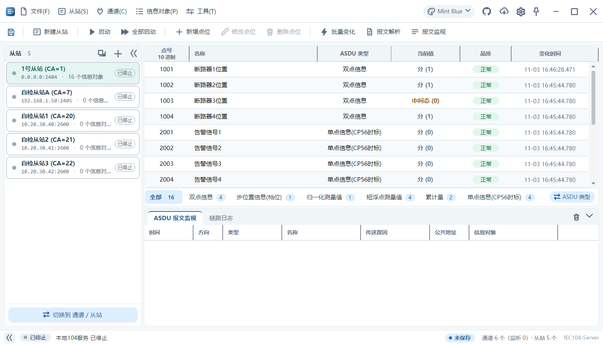
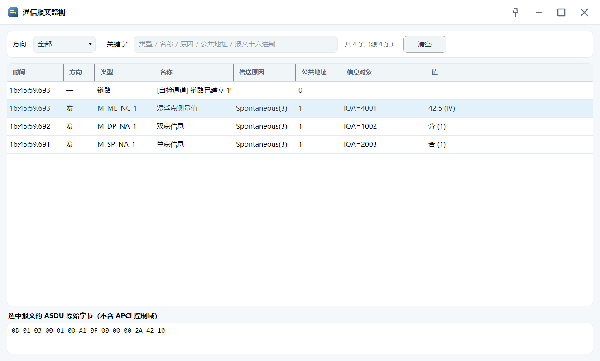
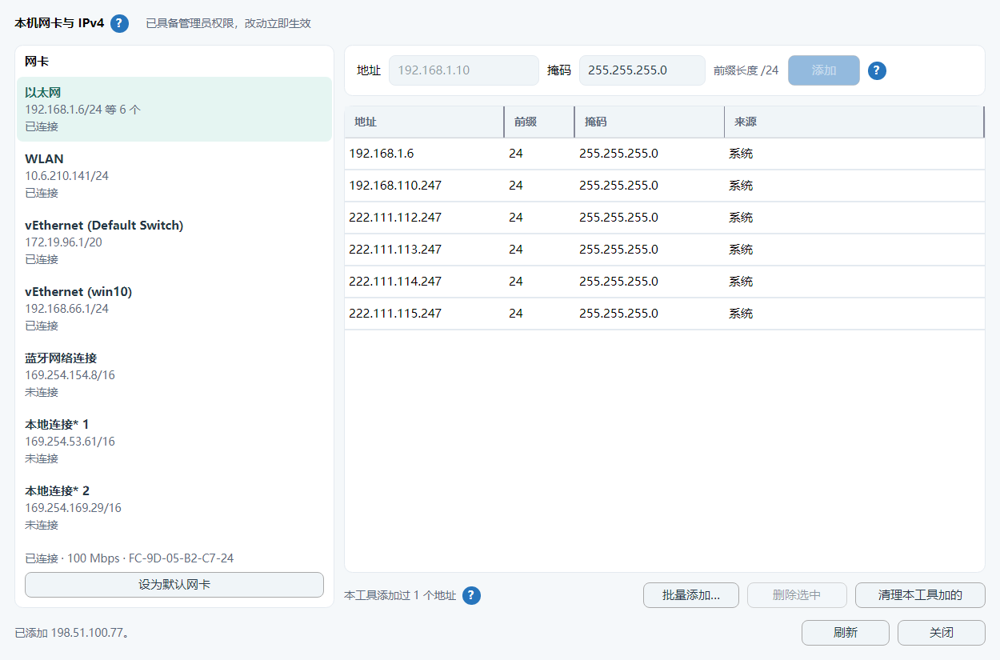
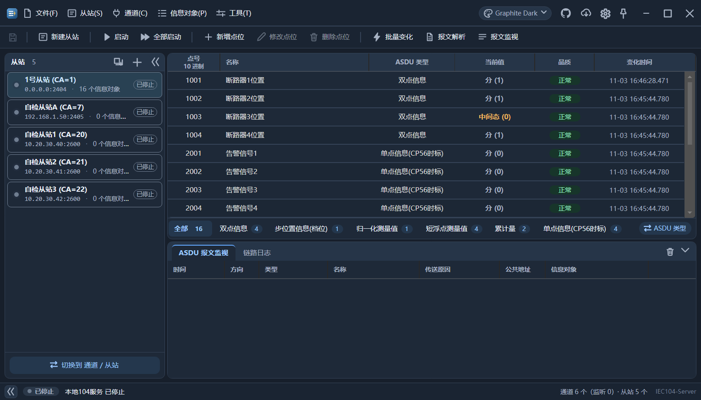

# IEC104-Server

**IEC 60870-5-104 从站仿真工具** —— 在一台 Windows 电脑上批量模拟变电站装置，用来测主站、调点表、复现现场问题。

不用连真设备，也不用装数据库：双击一个 exe，建几个从站，点表铺好，主站就能连上来收数、下命令。



---

## 它是什么

- **从站侧仿真器**：本机监听 TCP 2404（端口可改），扮演一个或多个 RTU/保护装置，应答主站的总召、遥控、对时、读数据。
- **点表工具**：按 ASDU 类型铺点（单点/双点/归一化/标度化/短浮点/累计量/比特串…），每个点有品质位、时标和两个值（初始值 / 最后值）。
- **调试台**：报文监视（带值列和原始字节）、报文解析、实时曲线、批量变化（按规则自动改值）。

## 它不是什么

- **不是主站**，不主动采集真实装置。
- **不接真实一次设备**：所有值都是本机仿真出来的，与现场设备无任何关联。
- **不要用于生产控制回路**：这是调试工具，遥信遥控都是假的。

## 功能

| | |
|---|---|
| 仿真规模 | 单进程 100 万点（托管内存 ≈ 289 MB）；40 万点开工程约 0.3 s |
| 建站 | 单个新建 / 批量创建（IP 与端口递增、末段自动进位、重复自动跳过） |
| 点表 | 按 ASDU 类型或电力四大类分组；单元格双击内联编辑、滚轮改值 |
| 命令应答 | 总召、电度总召、对时、单点/双点遥控、设定值、测试、读、复位进程 |
| 报文 | 实时监视（类型/方向/值/原始字节）、离线解析（任意报文长度组合） |
| 批量变化 | 按规则整批改值，参数窗口关掉也继续跑，工具条与状态栏有提示与停止 |
| 本机地址 | 新建从站时就告诉你「本机没有这个 IP」，可自动添加（提权 helper），支持批量添加与一键清理 |
| 工程 | `.iec104proj` 存通道/从站/点表与值，自动保存、崩溃前不丢、启动恢复上次工程 |
| 界面 | 六套主题（四浅两深），语义色令牌，适配 1366×768 与 1080p@150% |

<p>
  
  
</p>

<details>
<summary>深色主题</summary>



</details>

## 下载与运行

从 [Releases](../../releases/latest) 下载 `IEC104-Server.exe` 双击即可。

- **自包含单文件**，约 44 MB，不需要安装 .NET、不需要安装任何运行时。
- 只支持 **Windows x64**。
- 免安装：删掉 exe 就等于卸载。设置写在 exe 旁边的 `settings.json`，把整个文件夹拷到别的机器配置跟着走（程序目录不可写时自动回退到用户目录）。

## 快速上手

1. 双击 exe → 选「新建工程」（或直接跳过，先用临时从站试试）。
2. 「新建从站」：填名称、IP、端口、公共地址；本机没有这个 IP 时，勾上「启动通道时自动把 IP 添加到所选网卡」。
3. 「批量建点」：选 ASDU 类型、起始点号、个数，一次铺满。
4. 点「启动」，把从站的 IP:端口 给主站去连。主站连上来后，工具栏「通信报文监视」能看到收发报文。

## 在线更新

标题栏右上角的云下载按钮检查更新：比对 GitHub 上的最新版本 → 显示更新说明 → 下载 → 校验 SHA256 → 替换 → 重启。

- 更新包只从**发布页**取，不额外收集任何信息；检查失败（没网、被墙、GitHub 挂了）只提示一句，不影响使用。
- 也可以完全不用它：手动下载新 exe 覆盖旧的即可，工程与设置都不受影响。

## 从源码构建

需要 [.NET 8 SDK](https://dotnet.microsoft.com/download/dotnet/8.0)（Windows）。

```bat
:: 编译（框架依赖，跑得快，调试用）
build.bat

:: 发布单文件（自包含，和 Release 里那个一样）
build.bat gui
```

发布参数（单文件 / 自包含 / 压缩 / 不带 pdb）在
`src/IEC104.App/Properties/PublishProfiles/win-x64.pubxml` 里，
本地 `build.bat` 与 GitHub Actions 用的是同一份，不会出现"我这能跑、CI 出的包不能跑"。

`build.bat` 默认按作者的便携工具链目录找 SDK；找不到会退回 PATH 里的 `dotnet`。
用手写命令也行：

```bash
dotnet publish src/IEC104.App/IEC104.App.csproj -p:PublishProfile=win-x64 -o dist
```

## 界面自检

界面改动都要能证明"没改坏"。仓库里带一套自检（`--capture-ui`），会真的把窗口开出来、把控件量一遍，**185 条断言**，包括：

- 六套主题 × 关键控件：颜色必须等于语义令牌，且前景/背景对比度 ≥ 4.5:1
- 弹窗在小屏（520 高）下按钮仍可见、内容可滚
- 端口真开、主站真连、通道状态灯真变色
- 提权加 IP 的执行通道换成假实现，**绝不真动系统网络配置**
- 顺手把每个界面截一张图到输出目录

```bash
dotnet run --project src/IEC104.App/IEC104.App.csproj -- --capture-ui ./out
```

> 这套自检要真窗口，所以**只在本地跑**，CI 里只做编译（见 `.github/workflows/build.yml`）。

## 目录结构

```
src/IEC104.Core/       协议层：ASDU 编解码、类型注册表、链路
src/IEC104.Simulator/  从站行为：总召/命令应答、点值管理
src/IEC104.App/        Avalonia 界面（MVVM，手写，无第三方 MVVM 框架）
src/IEC104.Host/       控制台入口
docs/                  方案与规范（CHANGELOG.md 是更新说明的唯一来源）
```

界面规则、配色令牌、动作该放哪一层，都写在 [`界面设计规范.md`](界面设计规范.md) 里，改界面前先看那份。

## 规约覆盖

- **IEC 60870-5-104**（TCP）：完整实现，支持可配的传送原因/公共地址/信息体地址长度（1~2/1~2/1~3 字节）。
- **IEC 60870-5-101**（串口）：**尚未实现**。界面、参数、工程字段都已就位，链路层还是空壳（见 `Core/LinkLayer/PrimaryLinkLayer.cs`），欢迎补。

## 已知限制

- 只支持 Windows x64。
- 界面只有中文。
- 没有主站模式（不会主动连别人）。
- 101 串口未实现（见上）。

## 参与

- 提交信息格式：`<type>: <一句话摘要>` + 正文写清 **为什么改 / 踩了什么坑 / 验了什么**（详见 `docs/版本控制约定.md`）。
- 改界面请附一张 `--capture-ui` 的断言结果；改协议请说明真机/真链路怎么验的。
- 发版流程：先往 `docs/CHANGELOG.md` 加一段，再打 `v*` 标签 —— 剩下的事 Actions 会做（编译、算哈希、生成 update.json、建 Release）。

## 许可证

[MIT](LICENSE)。可自由使用、修改、商用，保留版权声明即可。
